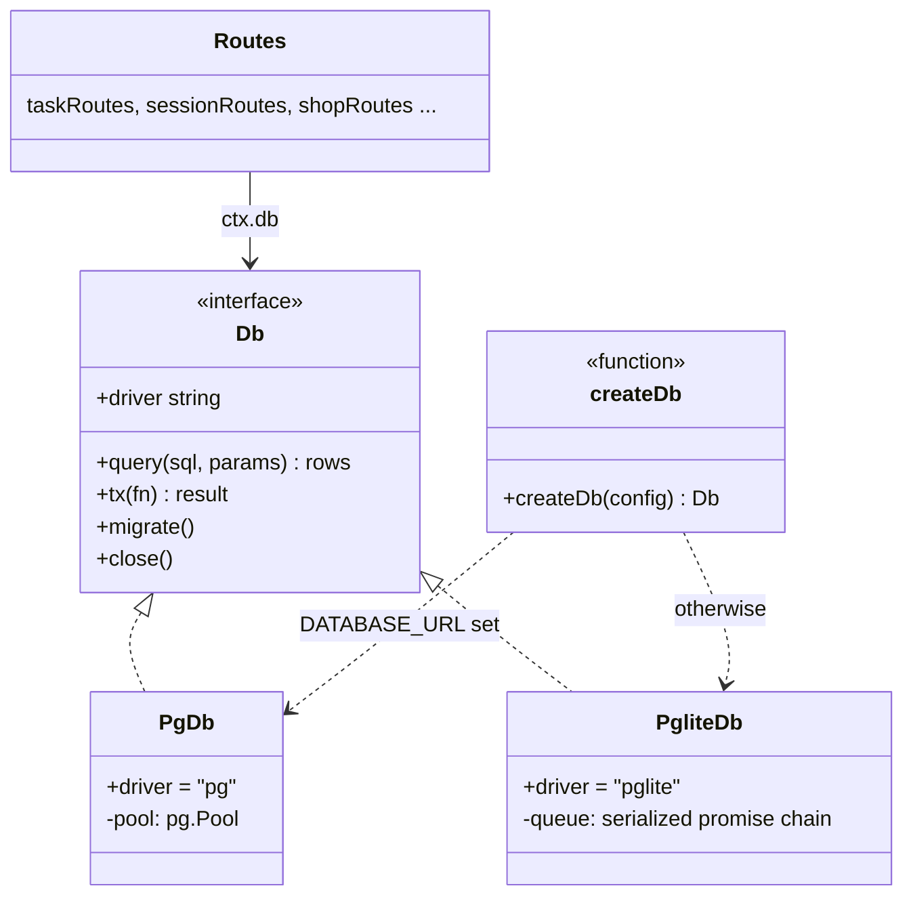

# Design Patterns

## Pattern: Strategy (interchangeable database drivers)

**Definition.** Strategy defines a family of interchangeable algorithms behind one interface, so the client code does not know or care which one it uses.

**Where.** `backend/src/db.js`

| Role | Rootine code |
|---|---|
| Strategy interface | An object with `query(sql, params)`, `tx(fn)`, `migrate()`, `close()`, `driver` |
| Concrete strategy A | `createPgDb(config)`: a `pg` connection pool for Supabase PostgreSQL (production) |
| Concrete strategy B | `createPgliteDb(config)`: PGlite, PostgreSQL running inside Node (local development and tests) |
| Selector | `createDb(config)`: picks A when `DATABASE_URL` is set, otherwise B |
| Client (context) | Every route in `backend/src/routes/*.js` through `ctx.db` |

### Problem it solves

The app must run on Supabase in production, but a student or grader should be able to run it with no database installed, and tests must be fast and isolated. Without a pattern, each route would need `if (production) ... else ...` around every query, and the tests would need a real server.

### Class diagram

### Walkthrough

1. `server.js` (or `api/index.js` on Vercel) calls `loadConfig()` and then `createDb(config)`.
2. `createDb` checks `config.databaseUrl`. With a value it returns the `pg` pool object. Without one it returns the PGlite object.
3. `createApp({ db, config, ... })` puts the chosen object in `ctx` and passes `ctx` to every route factory.
4. A route such as `tasks.js` calls `ctx.db.query('SELECT ...', [userId])`. It does not know which driver answers.
5. Tests call `createDb({ pgliteDir: 'memory' })`, so each test file gets a fresh in-memory database.

The same idea is used for the AI provider. `createAi(config)` returns an object with one method, `reply({ system, messages })`. The chat route depends only on that method, so `chat.test.js` swaps in a fake AI and `ai.js` could be swapped for another provider.

### Why Strategy and not an alternative

| Alternative | Why it is worse here |
|---|---|
| `if (isProduction)` branches in each route | Duplicates logic in about 10 route files, and every new route can forget a branch. |
| Singleton database object | Gives one shared instance but no way to swap implementations. Tests would share state. A fresh in-memory database per test is not possible. |
| Mock the `pg` module in tests | Tests would not run real SQL, so they would miss SQL mistakes. PGlite runs real PostgreSQL. |

### Trade-off

PGlite and `pg` can differ in small ways (for example bigint handling). `db.js` normalizes bigint results in both drivers so routes see the same values.

### Test evidence

| Test | File | Result |
|---|---|---|
| `strategy: createDb returns a driver with the shared interface` | `backend/tests/ai-client.test.js` | Passed (see [`TEST_REPORT.md`](TEST_REPORT.md)) |
| All 118 route tests run on the PGlite strategy | `backend/tests/*.test.js` | Passed |
| Chat route runs with an injected fake AI | `backend/tests/chat.test.js` | Passed |

The `pg` strategy is exercised only against a real Supabase database, which the automated tests do not do. That is a known gap (see the test report).
