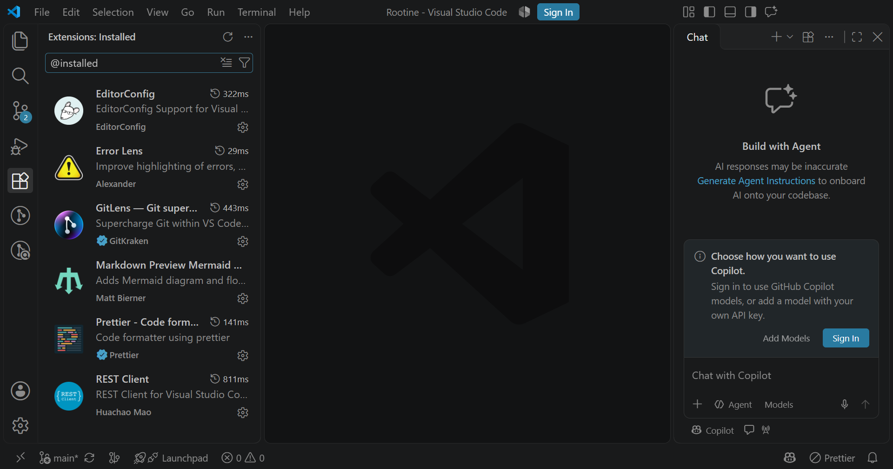
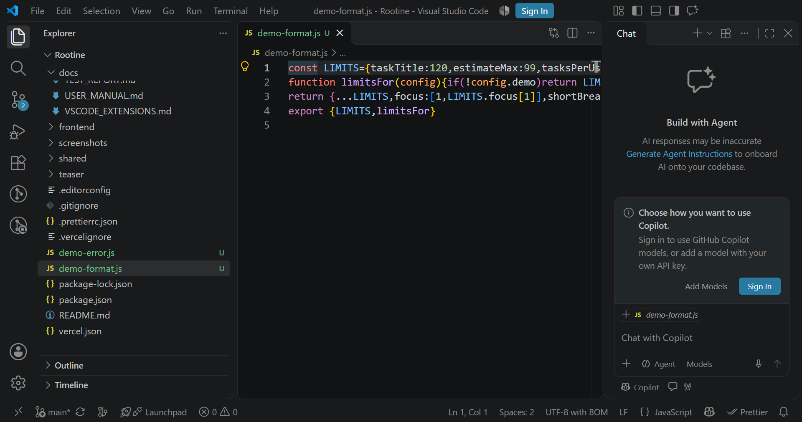
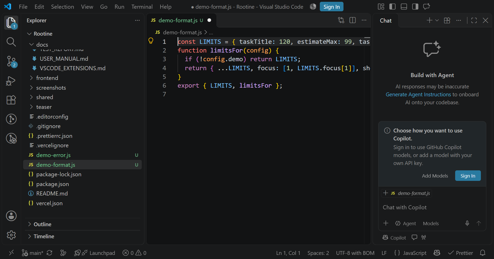
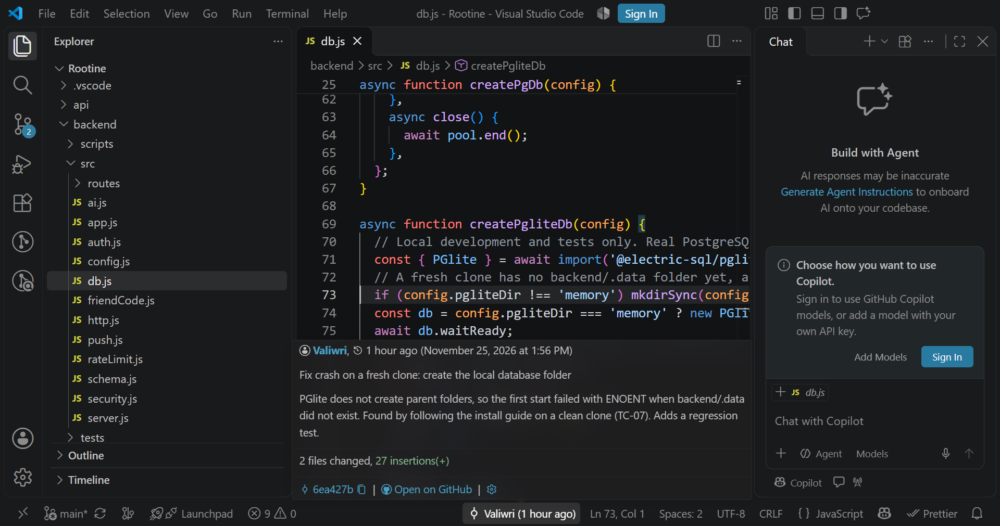
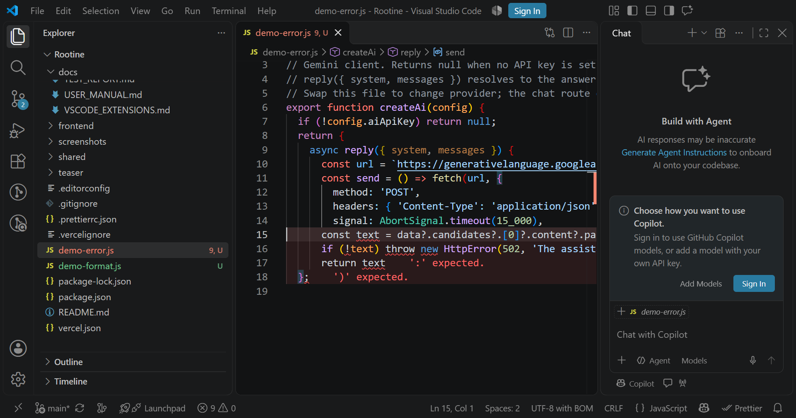
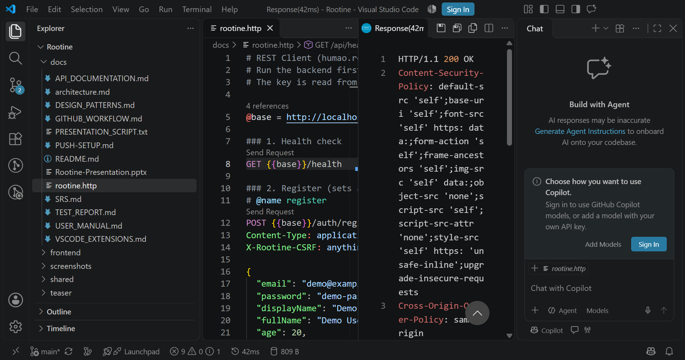

# VS Code Extensions Report

The workspace recommends these extensions in `.vscode/extensions.json`. VS Code offers to install them when the folder is opened. Settings are in `.vscode/settings.json`, `.prettierrc.json`, and `.editorconfig`. Debug setups are in `.vscode/launch.json`.

| # | Extension (ID) | Purpose | How it is used in Rootine |
|---|---|---|---|
| 1 | Prettier (`esbenp.prettier-vscode`) | Formats code on save | Rules in `.prettierrc.json`: single quotes, semicolons, width 140, matching the existing code style |
| 2 | GitLens (`eamodio.gitlens`) | Shows who changed each line and when, plus file and branch history | Inspect commit history and blame for the Git workflow evidence |
| 3 | Error Lens (`usernamehw.errorlens`) | Shows errors and warnings inline | Catch mistakes while editing `ai.js` and the routes |
| 4 | REST Client (`humao.rest-client`) | Sends HTTP requests from a file | `docs/rootine.http` calls `/api/health`, `/api/auth/register`, and `/api/chat` |
| 5 | EditorConfig (`editorconfig.editorconfig`) | Keeps indentation and line endings consistent | Rules in `.editorconfig` |
| 6 | Markdown Preview Mermaid Support (`bierner.markdown-mermaid`) | Renders Mermaid diagrams in the preview | Previews the diagrams in `docs/architecture.md` and `docs/DESIGN_PATTERNS.md` |

## Install and configure

1. Open the project folder in VS Code.
2. Accept the prompt "Do you want to install the recommended extensions?" or open the Extensions view, type `@recommended`, and install each.
3. Reload VS Code.
4. Prettier: confirm `.prettierrc.json` is picked up by running **Format Document** on a `.js` file.
5. REST Client: open `docs/rootine.http`, start the backend, click **Send Request** above a request.

## Installation evidence

Installed with the VS Code command line on 2026-11-25 (Windows 11). Output of `code --list-extensions --show-versions`, filtered to the six extensions:

```
bierner.markdown-mermaid@1.32.1
eamodio.gitlens@19.7.0
editorconfig.editorconfig@0.18.2
esbenp.prettier-vscode@12.4.0
humao.rest-client@0.25.1
usernamehw.errorlens@3.30.0
```

Install command used for each one: `code --install-extension <id>`. Prettier was already installed.

## Configuration files in the project

| File | What it configures |
|---|---|
| `.vscode/extensions.json` | Recommends the six extensions when the folder is opened |
| `.vscode/settings.json` | Prettier as default formatter, format on save, Error Lens on, LF line endings |
| `.vscode/launch.json` | "Debug backend" and "Debug current test file" |
| `.prettierrc.json` | Single quotes, semicolons, width 140, trailing commas |
| `.editorconfig` | 2-space indent, UTF-8, LF, final newline |
| `docs/rootine.http` | Requests for REST Client |

## Screenshots

Captured from a separate VS Code window that uses its own profile with the same six extensions and the project's `.vscode` settings, opened on a clone of this repository. The Error Lens and Prettier examples use two small demo files (`demo-error.js`, `demo-format.js`) that exist only in that clone and are not part of the project.

| # | Extension | What it shows |
|---|---|---|
| 1 | All six | The Extensions view filtered with `@installed` lists EditorConfig, Error Lens, GitLens, Markdown Preview Mermaid, Prettier, and REST Client |
| 2 | Prettier | Before: an unformatted file |
| 3 | Prettier | After: Format Document applied the rules of `.prettierrc.json` |
| 4 | GitLens | Hovering the blame in the status bar on line 73 of `backend/src/db.js` shows the commit `6ea427b`, "Fix crash on a fresh clone", its message, and "2 files changed, 27 insertions" |
| 5 | Error Lens | A broken copy of `ai.js` shows the errors inline (`')' expected.` and `':' expected.`) |
| 6 | REST Client | "Send Request" on `GET {{base}}/health` in `docs/rootine.http` returned `HTTP/1.1 200 OK` from the running backend |













## Reflection (write your own after using them)

- Which extension saved the most time, and why?
- Any conflict or limitation. Known to check: Prettier and the existing code style may reformat many lines on first run. Run it on one file and review the diff before formatting the whole project. REST Client cookies and the CSRF token must be passed manually, as in `rootine.http`.
