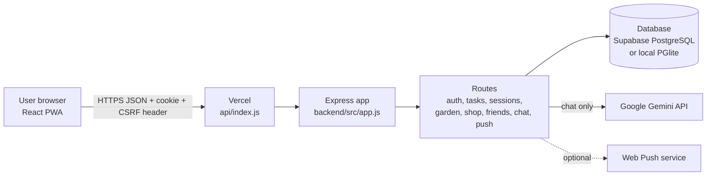
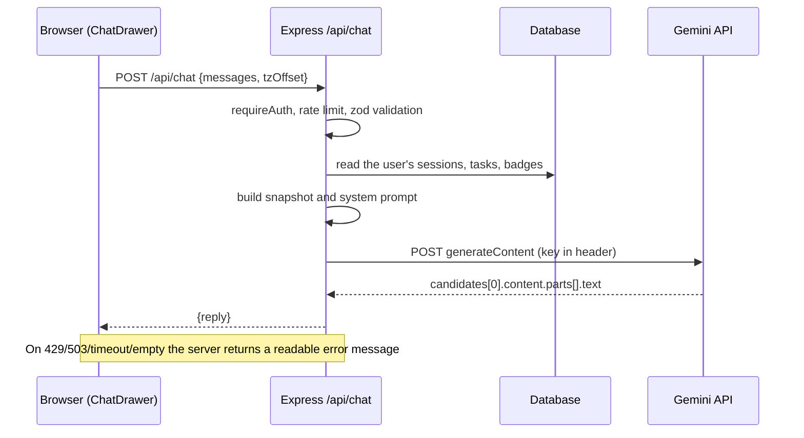

# Technical Design: Architecture

More detail: [`engineering/FULLSTACK-PLAN.md`](engineering/FULLSTACK-PLAN.md), [`backend/BACKEND-PLAN.md`](backend/BACKEND-PLAN.md), [`backend/DATABASE-SCHEMA.md`](backend/DATABASE-SCHEMA.md), [`frontend/FRONTEND-PLAN.md`](frontend/FRONTEND-PLAN.md).

## Component diagram

## Folder map

| Path | Role |
|---|---|
| `frontend/src/pages` | One file per screen (Focus, Tasks, Garden, Yard, Shop, Friends, Settings, Auth, Landing) |
| `frontend/src/components` | Reusable UI (timer overlay, plants, chat drawer, tour) |
| `frontend/src/lib` | Helpers (alerts, API calls) |
| `shared/plants.js` | Plant catalog used by both frontend and backend |
| `backend/src/app.js` | Builds the Express app. Receives `db`, `config`, `now`, `ai`, `pusher` so tests can inject fakes |
| `backend/src/config.js` | Reads environment variables once and holds limits |
| `backend/src/db.js` | Database strategies (see [`DESIGN_PATTERNS.md`](DESIGN_PATTERNS.md)) |
| `backend/src/ai.js` | Gemini client |
| `backend/src/auth.js`, `security.js`, `rateLimit.js` | Sessions, CSRF, hashing, rate limits |
| `backend/src/routes/*.js` | One router per feature |
| `backend/tests` | Automated tests (Node test runner) |
| `api/index.js`, `vercel.json` | Vercel serverless entry and headers |

## Data flow: asking Rootie

## Significant decisions

| Decision | Reason |
|---|---|
| The server builds the AI snapshot from the database | The browser cannot add or fake facts, and other users' data cannot leak. |
| Timer state lives on the server and uses server time | A user cannot shorten a session by changing the browser clock. |
| `now` and `ai` are injected into `createApp` | Tests use a fake clock and a fake AI, so they are fast and need no internet. |
| PGlite locally, Supabase in production | No install needed to run the project. |
| Plain `fetch` for Gemini | No extra dependency, and request and response are easy to document and test. |
